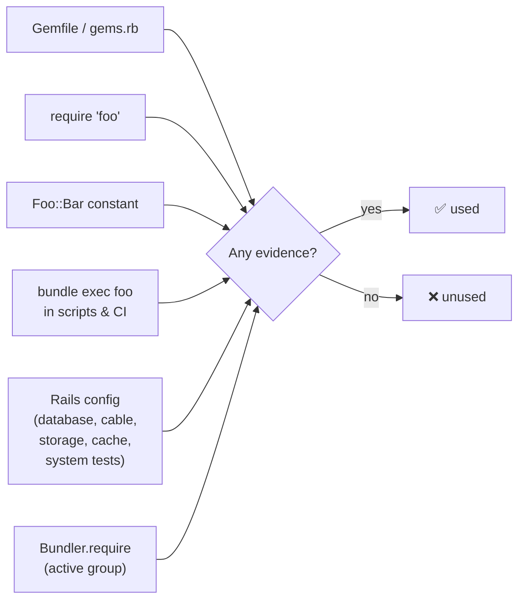
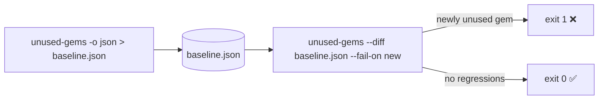

# unused-gems

Find gems in your `Gemfile` that your Ruby project never actually uses.

`unused-gems` is a fast Rust CLI that parses your Gemfile with [ruby-prism](https://github.com/ruby/prism) (Ruby's official parser), scans your source tree in parallel, and reports every gem with the **evidence** that proves it is used — or flags it as unused.

```console
$ unused-gems
❌ Unused (1)

  totally_unused_xyz  (default)

✅ Used (2)

  fileutils  json

3 gems: 2 used, 1 unused, 0 bundler.require
```

## How it works

A gem counts as **used** when at least one piece of evidence ties it to your project:



It knows each gem's real require paths and top-level constants by introspecting installed gems (rbenv, rvm, mise, asdf, chruby, `BUNDLE_PATH`, …) or `vendor/cache`, and it follows Bundler's rules for groups, platforms, `require: false`, `eval_gemfile` and `gemspec`.

See [docs/ARCHITECTURE.md](docs/ARCHITECTURE.md) for the full pipeline and Gemfile semantics.

## Installation

### Prebuilt binaries

Grab a binary from [GitHub Releases](https://github.com/mrecachinas/unused-gems/releases):

| Platform | Target |
|---|---|
| macOS (Apple Silicon) | `aarch64-apple-darwin` |
| macOS (Intel) | `x86_64-apple-darwin` |
| Linux (x86_64) | `x86_64-unknown-linux-gnu` |
| Linux (aarch64) | `aarch64-unknown-linux-gnu` |
| Windows (x86_64) | `x86_64-pc-windows-msvc` (`.zip`) |

```bash
TARGET=aarch64-apple-darwin   # pick from the table above
gh release download --repo mrecachinas/unused-gems --pattern "unused-gems-$TARGET.tar.gz"
tar xzf "unused-gems-$TARGET.tar.gz" && sudo mv unused-gems /usr/local/bin/
```

### From source

Requires [Rust](https://www.rust-lang.org/tools/install) 1.88+ (the MSRV tested in CI).

```bash
cargo install --path .
```

## Usage

```bash
unused-gems                          # scan the current directory
unused-gems path/to/project          # scan another project
unused-gems -v                       # show the evidence for every gem
unused-gems -o json                  # machine-readable output
unused-gems -o github                # GitHub Actions annotations
unused-gems --sarif                  # SARIF for code scanning

unused-gems --skip-dirs tmp,app/legacy        # skip extra directories
unused-gems --rails-env development,test      # treat these groups as Bundler.require'd
unused-gems --gemfile a/Gemfile --gemfile b/Gemfile   # monorepo: several Gemfiles, one scan
```

### Options

| Option | Description |
|---|---|
| `-o, --output <FORMAT>` | `text` (default), `json` or `github` |
| `-v, --verbose` | Show evidence, require paths and transitive dependency counts |
| `-q, --quiet` | Suppress progress messages |
| `-j, --jobs <N>` | Scanner threads (overrides the default walker cap of 4) |
| `--gemfile <PATH>` | Gemfile to analyze; repeat for monorepos (default: `Gemfile`, then `gems.rb`) |
| `--ignore-file <PATH>` | Config file (default: `.unused_gems.yml`, relative to the scanned dir) |
| `--skip-dirs <DIRS>` | Extra directory names or root-relative paths to skip |
| `--rails-env <ENVS>` | Rails environment groups considered active for `Bundler.require(*Rails.groups)` |
| `--diff <BASELINE>` | Compare against a previous `-o json` run |
| `--fail-on <POLICY>` | `any` (default), `new` (only newly unused gems, needs `--diff`) or `none` |
| `--sarif` | Emit SARIF JSON (ignored with `--diff`) |
| `--no-cache` | Ignore the `.unused_gems_cache` file cache |
| `--allow-missing-gemfile` | Exit `0` with a notice instead of failing when no Gemfile exists |

### Exit codes

| Code | Meaning |
|---|---|
| `0` | No unused gems (or `--fail-on none`, or `--fail-on new` with nothing new) |
| `1` | Unused gems found (per `--fail-on`) |
| `2` | Fatal error: bad arguments, invalid directory, missing/unreadable/invalid Gemfile, or invalid `--diff` baseline |

## Using it in CI

Record a baseline once, then fail builds only when something **new** becomes unused:



```bash
unused-gems -q -o json > baseline.json
# later, in CI:
unused-gems --diff baseline.json --fail-on new -o github
```

Diff output reports `newly_unused`, `no_longer_unused`, `status_changed`, `added` and `removed` gems. With `-o github` each newly unused gem becomes a warning annotation on the Gemfile.

## Configuration

Create `.unused_gems.yml` in the project root:

```yaml
# Gems to never report
ignore:
  - development-only-gem

# Map custom Rails config values to the gem that provides them
adapters:
  database:
    clickhouse: clickhouse-activerecord
  cable:
    custom_cable: custom-cable-gem
  storage:
    CustomStorage: custom-storage-gem
  cache:
    custom_cache_store: custom-cache-gem
```

Common database, cable, storage, cache and system-test drivers are recognised out of the box; see [Rails configuration evidence](docs/ARCHITECTURE.md#rails-configuration-evidence).

## Gem statuses

| Status | Meaning |
|---|---|
| `used` | Direct evidence found (require, constant, script, or Rails config) |
| `bundler_required` | No direct reference, but auto-required by `Bundler.require` in an active group |
| `unused` | No evidence at all |
| `ignored` | Listed in `.unused_gems.yml` |
| `platform_excluded` | Only declared for platforms other than the current one |

## Performance

On github/github (~53K Ruby files) a full scan takes **~2.8s** — SIMD byte scanners instead of regex, parallel walking with rayon, and a per-file cache that skips unchanged files on repeat runs.

```bash
cargo bench -- --save-baseline main   # before a change
cargo bench -- --baseline main        # after
```

## Development

```bash
cargo build
cargo test
BENCH=1 cargo run -- path/to/project   # per-stage timings
```

Architecture, module map and detailed semantics live in [docs/ARCHITECTURE.md](docs/ARCHITECTURE.md).
