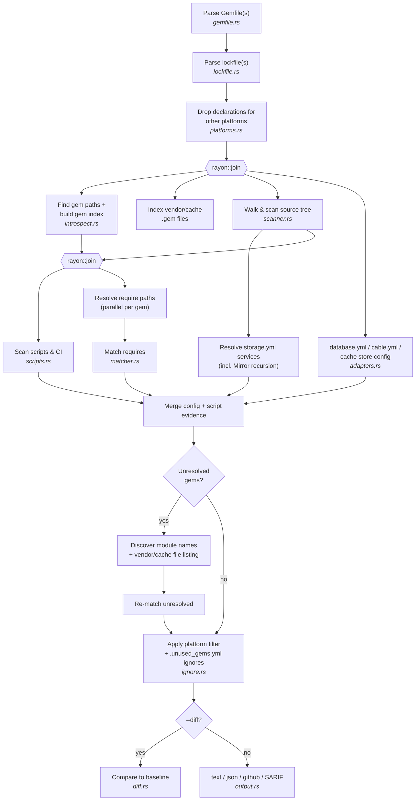
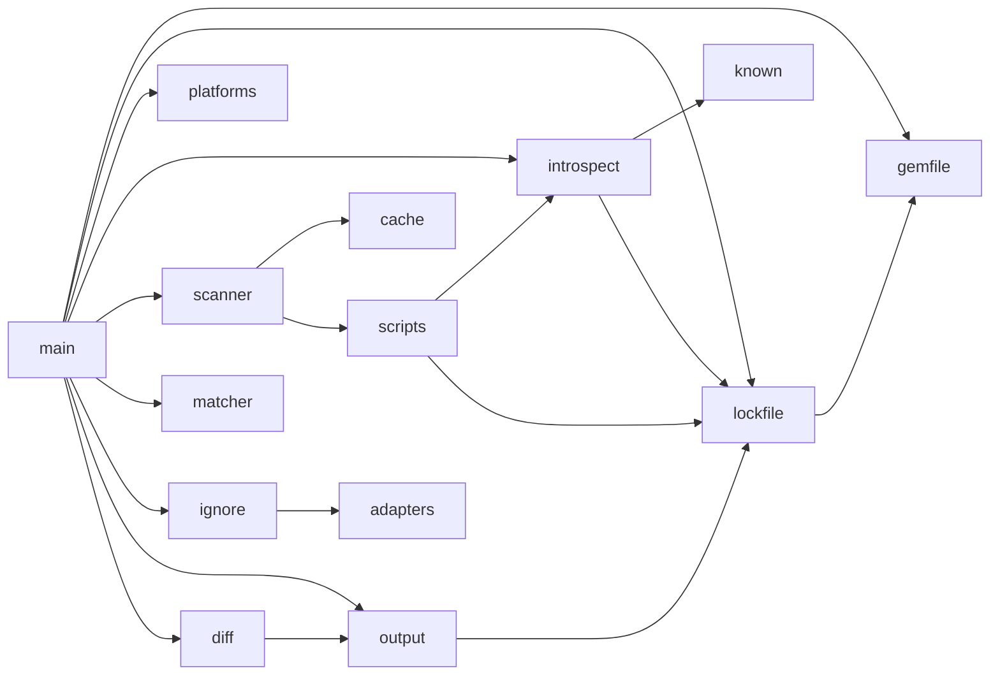
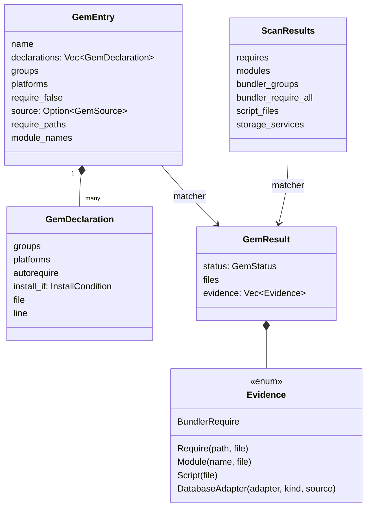
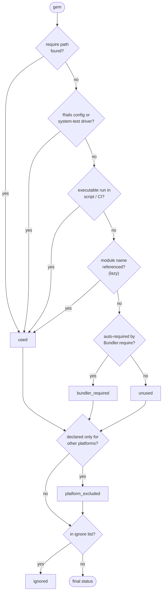
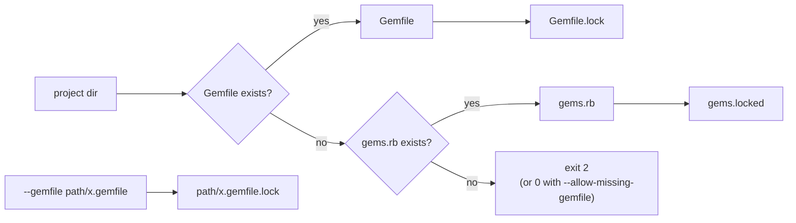
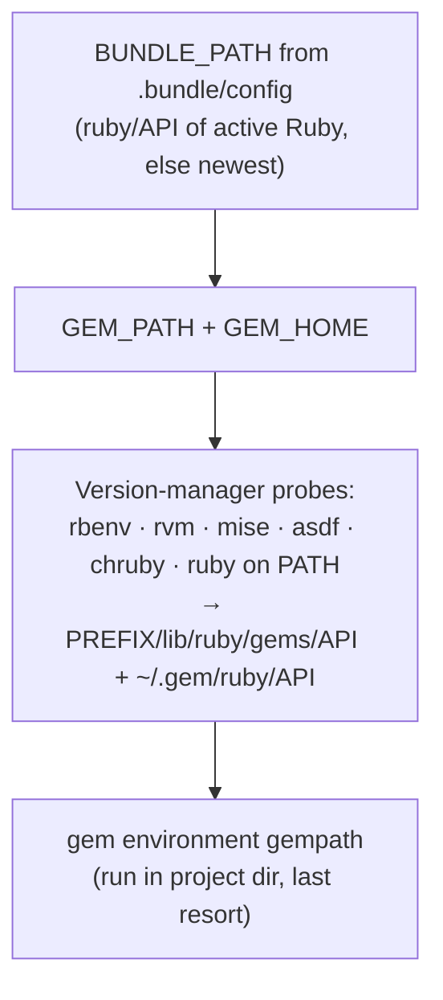
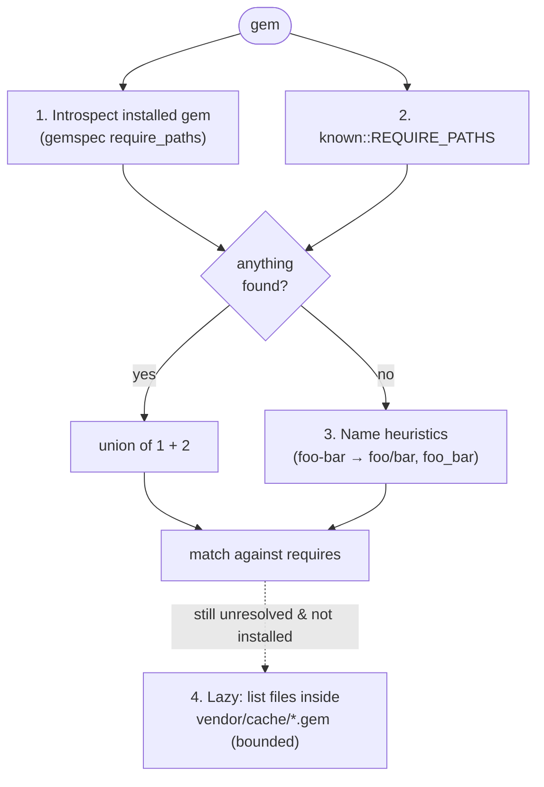
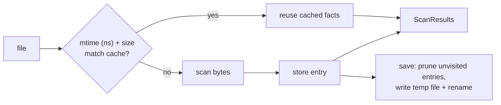
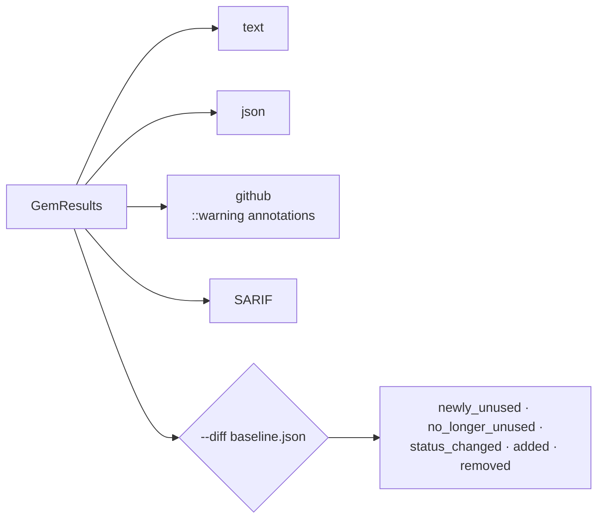

# Architecture

This document explains how `unused-gems` decides whether a gem is used. For installation and everyday usage, see the [README](../README.md).

- [Pipeline](#pipeline)
- [Module map](#module-map)
- [Data model](#data-model)
- [How a gem gets its status](#how-a-gem-gets-its-status)
- [Gemfile semantics](#gemfile-semantics)
- [Finding installed gems](#finding-installed-gems)
- [Require paths and module names](#require-paths-and-module-names)
- [Source scanning](#source-scanning)
- [Script and CI detection](#script-and-ci-detection)
- [Rails configuration evidence](#rails-configuration-evidence)
- [Output and diff mode](#output-and-diff-mode)
- [Performance](#performance)
- [Testing](#testing)

## Pipeline

`main.rs` orchestrates one linear pipeline, using `rayon::join` to run independent stages concurrently. Expensive module-name discovery runs lazily, only for gems that the cheaper evidence did not resolve.



Set `BENCH=1` to print the duration of every `timed!` stage.

## Module map

All modules live flat under `src/` and are function-based (no traits).

| Module | Responsibility |
|---|---|
| `main.rs` | CLI (clap), pipeline orchestration, Rails config scanners, exit codes |
| `types.rs` | Shared types: `GemEntry`, `GemDeclaration`, `ScanResults`, `GemResult`, `Evidence` |
| `gemfile.rs` | Gemfile / `gems.rb` / gemspec parsing via the ruby-prism AST |
| `lockfile.rs` | `Gemfile.lock` / `gems.locked` parsing, locked versions, transitive dependency counts |
| `platforms.rs` | Bundler platform tokens and current runtime platform resolution |
| `introspect.rs` | Locating installed gems, require paths, module names, namespace ownership, vendor/cache |
| `known.rs` | Curated require paths and module names for gems that heuristics get wrong |
| `scanner.rs` | Parallel directory walk and hand-rolled byte scanners for Ruby, ERB, Haml, Slim, YAML |
| `cache.rs` | Bincode per-file scan cache (`.unused_gems_cache`) |
| `scripts.rs` | Gem executables in Rake, shell, Make, Docker, Procfile, CI YAML and mise tasks |
| `adapters.rs` | Built-in and user-provided Rails adapter → gem mappings |
| `matcher.rs` | Turns scan results into evidence-backed `GemResult`s |
| `ignore.rs` | `.unused_gems.yml` loading |
| `output.rs` | Text, JSON, GitHub annotations and SARIF output |
| `diff.rs` | Baseline comparison |



Most modules also share `types`. The Rails config scanners (`database.yml`, `cable.yml`, cache store, storage and system tests) currently live in `main.rs` and use the mappings from `adapters.rs`.

## Data model



`groups`, `platforms` and `require_false` on `GemEntry` are aggregates; Bundler-related decisions are always made per declaration.

## How a gem gets its status

Evidence sources are tried roughly from cheapest to most expensive. Once a gem is `used`, later stages only add evidence.



### Bundler.require

`Bundler.require` accepts explicit symbol or string group names, including multiline parenthesized calls; only arguments inside the call count. When `Bundler.require(*Rails.groups)` is detected, only `:default` gems are considered auto-required unless `--rails-env` activates more groups. Dev/test-only gems with no direct reference are therefore reported as `unused` by default.

A gem is auto-required when **any** of its declarations:

1. is in an active group,
2. applies to the current platform, and
3. has autorequire enabled (`require: false`, `require: nil` and `require: []` disable it), and
4. has an `install_if` that is not statically false.

## Gemfile semantics

### Discovery and lockfiles



- An existing `Gemfile` wins over `gems.rb`, even if it is invalid.
- Every analyzed Gemfile (including `eval_gemfile` targets) must be a readable regular file with valid Ruby syntax, otherwise the run exits `2`. `--allow-missing-gemfile` does not suppress this.
- Lockfiles of Gemfiles that are not analyzed are ignored.

### Declarations

- Every `gem` declaration is kept separately, as Bundler does with duplicates.
- Group and platform names may be symbols or strings; the options hash may be braced (`gem "x", ">= 0", { require: false }`). `groups:` beats `group:`, `platform:` beats `platforms:`.
- `install_if` (option or block) is evaluated when its condition is a literal such as `-> { false }`, `true` or `nil`. Statically false conditions are never `Bundler.require`d; anything else is treated as possibly true.

### Sources

A gem's source comes from `path:`, `git:`, the `github:`/`gitlab:`/`gist:`/`bitbucket:` shorthands, any custom `git_source(:name)`, or an enclosing `path`/`git`/`github` block. `source` blocks reset it and `eval_gemfile` inherits it. Path gems resolve to the directory itself or an immediate subdirectory holding `<name>.gemspec` (Bundler's `{,*,*/*}.gemspec` glob); `~` is expanded.

For path gems inside the scanned tree, files under the gem's own directory do not count as usage evidence for that gem, but still count for other dependencies. The project itself (a root `gemspec` or `path: '.'`) is exempt.

### `eval_gemfile`

- Evaluated inline, so gems appear in source order and inherit the enclosing `group`/`platforms`.
- Relative paths resolve against the declaring Gemfile. `File.expand_path`, `File.join`, `File.dirname`, `__FILE__` and `__dir__` are evaluated with Ruby semantics (e.g. `File.expand_path(p, __FILE__)` uses the Gemfile path itself as base; `File.join('a', '/b')` is `a/b`).
- A file evaluated more than once contributes declarations under each context, including via symlink or `..` aliases. Cycles are broken by tracking the active evaluation stack.
- Unsupported or unresolvable expressions produce a warning.

### `gemspec`

- Root gemspecs are parsed only for a bare `gemspec` directive; `path:` gemspecs are parsed from that directory. `name:` and `development_group:` are honored.
- Only the immediate directory is searched (`*.gemspec` plus a bare `.gemspec`). `name:` matches the parsed `spec.name`, not the file name. Selection is deterministic; zero candidates or several distinct `[name, version]` pairs produce a warning.
- Following Bundler ≥ 2.6, the gem itself is a `:default`, all-platform path source, and **development** dependencies go only into the development group — even inside a `group`/`platforms` block. Runtime dependencies are left to transitive resolution.
- An explicit Gemfile declaration always wins over a duplicate gemspec development dependency.

## Finding installed gems

`introspect::find_gem_paths` stops at the first layer that yields results:



Installed versions are ordered with `Gem::Version` semantics (prereleases first). Lockfile versions and git revisions **constrain** which installation is introspected: if the locked version is missing, a warning is printed once and the gem falls back to curated metadata, heuristics and matching `vendor/cache` artifacts — never another installed version or a stale checkout. Without a lockfile, registry gems use the newest installed version.

## Require paths and module names

### Require paths



Inside a gem's `lib/`, only these become require roots:

- `lib/*.rb` stems,
- folders named after the gem (including hyphen → slash, e.g. `rubocop/performance`),
- folders with their own `<folder>.rb` that no other Gemfile gem claims.

Other folders are **namespace extensions** whose files are listed individually. This is why `solid_cache`'s `lib/active_support/` never claims `require "active_support"`.

### Module names

Module names are the union of:

1. top-level declarations in `lib/<gem>.rb` (parsed with ruby-prism),
2. `known::MODULE_NAMES`,
3. PascalCase heuristics.

`NamespaceClaims` then removes constants owned by another gem (Gemfile, installed or known table; longest prefix wins) or shared by a family (e.g. `Google::Cloud`), except namespaces of undeclared direct lockfile dependencies. Ruby core/stdlib constants are never evidence.

## Source scanning

### Walking

- Parallel walk via the `ignore` crate; generated sources are scanned even when gitignored.
- Symlinks are followed; loops are skipped.
- `--skip-dirs` entries match directory names, or root-relative paths when they contain a separator (`app/legacy`).

### Byte scanners

No per-file regex: scanners use `memchr::memmem::Finder` (SIMD) and per-file dedup over borrowed `&[u8]` before touching shared maps. Lexer memo caches keep malformed input linear.

What is ignored:

| File type | Filtered out |
|---|---|
| All | `#` comment lines |
| Ruby (incl. extensionless Ruby-shebang scripts) | `=begin`/`=end`, heredoc bodies, string/regex/percent-literal interiors (except `#{}`), `__END__` data, inline comments |
| Haml / Slim | Everything but attributes, `=` output, script lines (with `,`/`\` continuations) and `#{}` |
| RuboCop / Standard YAML | Parsed with serde_yaml for `require`, `plugins`, `inherit_gem`; line-based fallback for ERB configs |

### File cache



Each entry holds everything a file contributes (requires, constants, Bundler groups, storage service names). Bump `CACHE_VERSION` in `cache.rs` whenever entry contents change. Source files are never re-read outside the walker: new per-file facts must be collected in `scan_file_bytes_with` and exposed through `FileResult`/`ScanResults`.

## Script and CI detection

`scripts.rs` scans Rakefiles/`*.rake`, shell scripts, Makefiles, Dockerfiles, Procfiles, CI YAML (including Drone `commands:`) and `mise.toml`/`.mise.toml` tasks (`run` strings or arrays, `[tasks]` shorthand).

Only words in **command position** count — after `bundle exec`, `bin/`, or `&&`/`;`/`|`. Arguments and descriptions never do. Executables map to gems via installed gemspecs, a curated table and `-`/`_` normalisation.

## Rails configuration evidence

| Kind | Source | Notes |
|---|---|---|
| `database` | `config/database.yml` | Built-in adapters incl. `postgis`, `sqlserver`, `oracle_enhanced`, `cockroachdb` (credit adapter gem **and** driver); static `url:` schemes and literal `ENV.fetch("DATABASE_URL", "…")` defaults; unknown adapters fall back to `<adapter>` or `activerecord-<adapter>-adapter` |
| `cable` | `config/cable.yml` | `async`/`inline`/`test` credit nothing |
| `storage` | `config/storage.yml(.erb)` | Only services actually selected in `config/application.rb`, `config/environments/*.rb` or attachment `service:` options. YAML aliases/merge keys supported; `Mirror` recursively credits `primary` and `mirrors` with cycle protection; `Disk`/`Mirror` credit nothing |
| `cache` | `config/application.rb`, `config/environments/*.rb` | `memory_store`/`file_store`/`null_store` credit nothing |
| `system_test` | Files referencing `ActionDispatch::SystemTestCase` or `Capybara` | `ActionDispatch::SystemTestCase` credits `capybara`; `driven_by :selenium`, `Capybara.default_driver`/`javascript_driver = :selenium_*`, `:cuprite`, … credit the driver gem |

Custom mappings come from the `adapters:` section of `.unused_gems.yml`. In JSON this evidence has `"type": "database_adapter"` (kept for compatibility) plus `kind` and `source`.

## Output and diff mode



JSON diff output has this shape:

```json
{
  "schema_version": "1",
  "diff": {
    "newly_unused": [],
    "no_longer_unused": [],
    "status_changed": [],
    "added": [],
    "removed": []
  },
  "new_unused_count": 0
}
```

`--fail-on new` only has an effect together with `--diff`; without it a warning is printed and the exit code is `0`.

## Error handling

There are no custom error types. Missing gems, bad caches and malformed config are reported with `eprintln!` and skipped. Only fatal input errors (bad arguments, invalid directory, missing/invalid Gemfile, invalid `--diff` baseline) exit `2`.

## Performance

- **ruby-prism** for exact Gemfile/gemspec ASTs.
- **SIMD byte scanners** (`memchr`) instead of regex in hot paths; allocation-free extension and comment checks.
- **rayon** for concurrent stages (`rayon::join`) and per-gem work (`par_iter`).
- **Lazy introspection**: module discovery and vendor/cache listing run only for still-unresolved gems.
- **Bincode file cache** keyed by mtime + size.

The benchmark suite in `benches/` covers cold and warm end-to-end runs, source-tree scaling, comment/heredoc-heavy Ruby and gitignored generated sources:

```bash
cargo build --release
cargo bench -- --save-baseline main
cargo bench -- --baseline main   # after a change
```

## Testing

```bash
cargo test                           # everything
cargo test --test byte_scanner_test  # byte scanners vs. regex baselines
cargo test --test accuracy           # end-to-end fixtures
```

| Suite | Covers |
|---|---|
| `tests/byte_scanner_test.rs` | Byte scanners agree with regex baselines |
| `tests/accuracy.rs` | End-to-end fixtures in `tests/accuracy_fixtures/` (see its README) |
| `tests/gemfile_semantics.rs` | Bundler-compatible Gemfile behavior |
| `tests/script_formats.rs` | Script and CI format detection |
| Unit tests | Edge cases per module: inline comments, heredocs, YAML comments, group handling, gemspec detection |
